# ChipNest · 智能元件管家

把电子元件的位置、数量和 BOM 取料放在同一张货架网格里。
**当前版本 v1.10.0**，新增连续交互、卡片拖放与共用格移动。
提供 Windows 安装包，安装后无需配置 Python。
没有 ESP32 硬件也能使用库存管理，连接状态显示为「模拟」。

[下载安装包](https://github.com/DWZ753/chip-nest/releases/latest) ·
[版本更新](docs/release-notes-v1.10.0.md) ·
[反馈问题](https://github.com/DWZ753/chip-nest/issues)

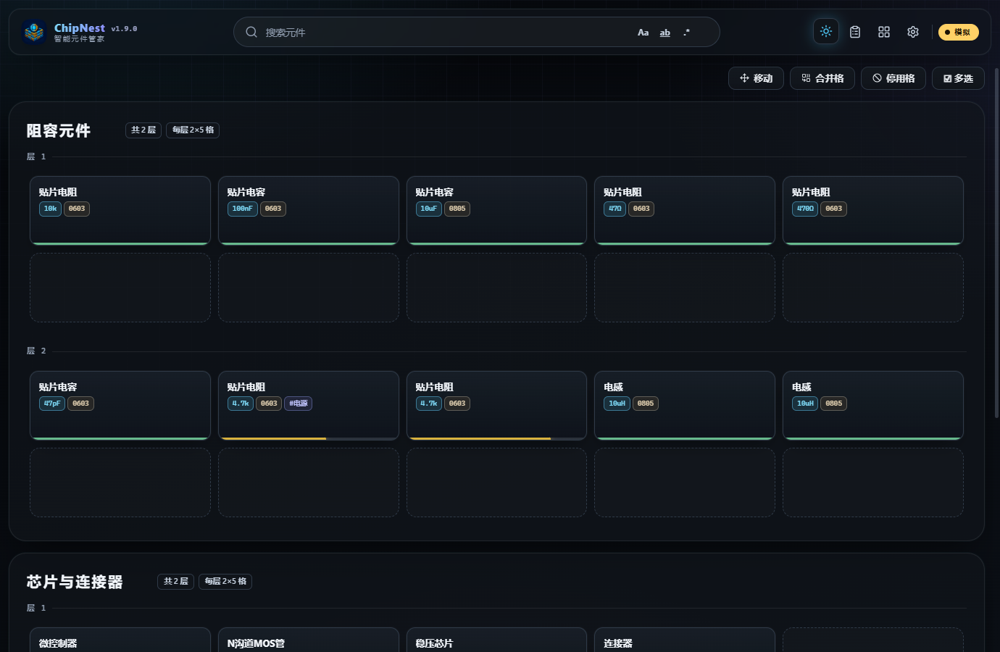

总览与下方五项功能演示使用 v1.9.0 实际界面和独立演示库存录制。
现有演示尚未更新为 v1.10.0 的连续交互与顶部工具栏。
未变更的流程沿用 v1.8.0 演示。
箭头指针平滑移动，点击时短暂缩小并显示青色光圈。
演示先展示入口点击，子菜单打开后平滑放大；选格或退出前缩回全景。
位置编号沿用软件显示。

[观看 v1.9.0 功能演示视频](https://github.com/DWZ753/chip-nest/releases/download/v1.9.0/ChipNest-v1.9.0-demo.mp4)
涵盖盘点与撤销、项目继续取料、补货导出、合并核对和备份恢复。

**快速导航**:
[安装](#安装与升级) · [菜单](#菜单与入口) ·
[搜索](#搜索与定位) · [入库](#入库) · [BOM 取料](#bom-取料) ·
[盘点与补货](#盘点与补货) · [格子](#格子管理) ·
[备份](#备份与恢复) · [开发](#源码运行与打包)

## 安装与升级

1. 从 [Releases](https://github.com/DWZ753/chip-nest/releases/latest)
   下载 `ChipNest-Setup-1.10.0.exe`。
2. 升级前关闭正在运行的 ChipNest，再运行安装程序。
3. 启动后在左上角或「设置 → 关于」核对版本号。

**库存数据**: `%APPDATA%\ChipNest\chipnest.db`。
覆盖安装和卸载程序不会主动删除这份数据。
迁移电脑前建议在「设置 → 备份与恢复」下载一份 JSON 备份。

### 第一次使用

1. 在「仓库布局」设置区名称，以及各区的层数、行数和列数。
2. 点空格新建元件，或从「库存 → 入库」批量录入。
3. 在主界面搜索元件；收到元件时入库，使用时出库或按 BOM 取料。

## 菜单与入口

| 入口 | 页面 / 操作 | 用途 |
| --- | --- | --- |
| 库存 | 入库 | 手工录入、BOM 整表入库 |
| 库存 | BOM 取料 | 保存项目、制作份数、匹配库存、继续取料、新建制作副本 |
| 库存 | 元件整理 | 合并重复元件、清除选中元件的供应商料号 |
| 库存 | 盘点 | 填写实盘数量、核对差异、批量校正 |
| 库存 | 补货清单 | 汇总阈值与多个项目剩余需求、导出 CSV |
| 库存 | 操作记录 | 查看最近操作、逐步撤销 |
| 仓库布局 | 布局配置 | 添加 / 删除区、区名称、各区层数与行列尺寸 |
| 设置 | 外观 | 深浅主题、字号、多格卡片合并或分开显示 |
| 设置 | 硬件 | 连接状态、灯带序号重排 |
| 设置 | 备份与恢复 | 自动备份策略、目录、历史、下载与恢复 |
| 设置 | 数据清理 | 清空所有数据 |
| 设置 | 关于 | 当前版本 |
| 主界面 | 移动 / 合并格 / 停用格 / 多选 | 调整存放位置与管理格子 |

## 搜索与定位

搜索覆盖名称、标称值、封装、厂商料号、供应商料号、标签，
也支持中文名称的拼音首字母。默认匹配字段中的部分文字。

| 按钮 | 作用 | 示例 |
| --- | --- | --- |
| `Aa` 区分大小写 | 按输入的字母大小写匹配 | `stm32` 与 `STM32` 可得到不同结果 |
| `ab` 全字匹配 | 匹配完整词项 | `47pF` 命中，`470pF` 不命中 |
| `.*` 使用正则表达式 | 按表达式筛选字段 | `^47(pF\|Ω)$` 匹配 `47pF` 或 `47Ω` |

三个选项可以组合。不匹配的卡片与停用格一起变暗，格子位置保持原样。
命中数量按元件统计，多格共用同一个元件只计一次。
用上下按钮或 `Enter` / `Shift+Enter` 在结果之间定位。

**演示**: 部分匹配 → 全字匹配 → 正则匹配 → 大小写切换。

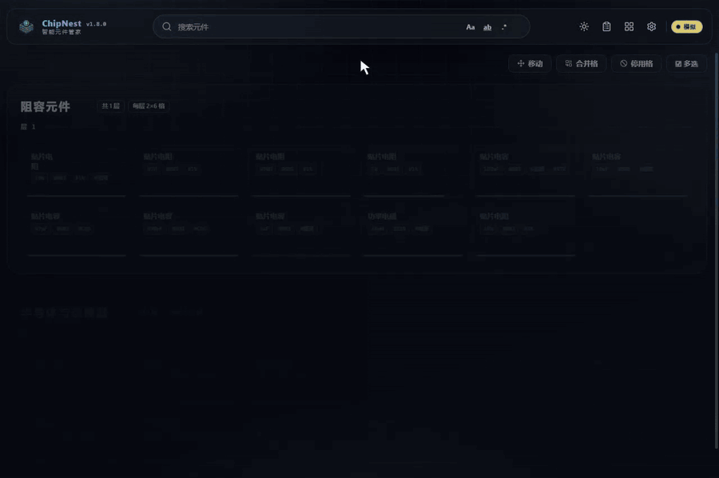

## 元件档案与库存

点已有卡片打开编辑窗口；点空格创建新元件。
卡片底部色条表示库存状态，悬停可以查看数量。

| 字段 | 用途 |
| --- | --- |
| 名称 / 标称值 / 封装 | 描述元件类型和规格 |
| 厂商料号 / 供应商料号 | 搜索、BOM 匹配与采购核对 |
| 标签与显示 | 设置标签，选择卡片展示的字段并调整顺序 |
| 补货阈值 | 标记库存偏低的元件 |
| 当前库存 | 设置操作数量后点「入库」或「出库」 |

「联网识别」可以根据料号或描述提供候选信息，确认后再保存；
离线时可以继续手工填写。

规格查询会核对元件类别、标称值、封装、额定电压和安装方式。
例如 `1k 0603` 匹配 1kΩ 的 0603 电阻；`470uF 25V 贴片`
匹配对应容量、电压的贴片电容。「直插」「插件」以及 SMD、THT
也可识别；明确指定的规格没有匹配结果时，不自动填入其他规格。

<details>
<summary>查看元件字段截图</summary>

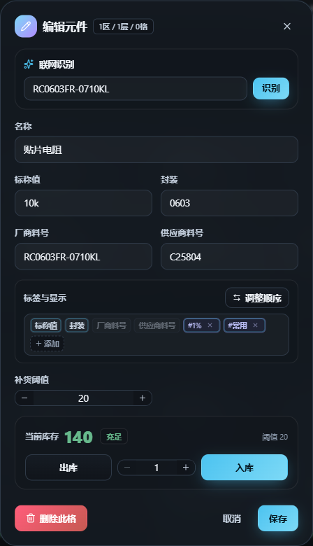

</details>

**演示**: 同一元件入库 5 件，再出库 2 件，数量与状态即时更新。
库存不足时不能超量出库。

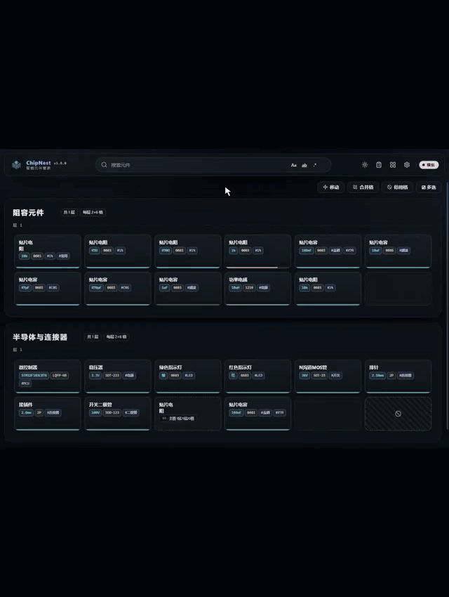

## 入库

### 手工入库

进入「库存 → 入库」，点击「手工入库」，填写名称、规格、料号与数量。
位置会优先分配空格；点击位置按钮可以重新选格。
选格时窗口暂时让开，在主页面点空格完成选择，`Esc` 取消。
核对后点「入库」；多种元件可以添加多行一起录入。

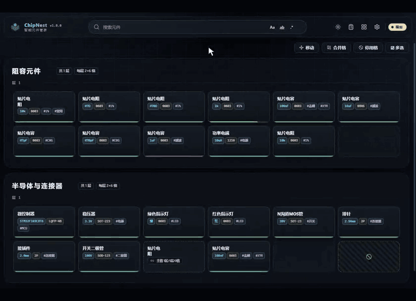

### BOM 整表入库

在同一页面粘贴清单并点「解析预览」，或导入 `.xlsx`、`.csv`、`.txt` 文件。
点击「整表入库」后逐行检查字段、数量与位置，再点「全部入库」。
也可以使用联网识别补充料号。

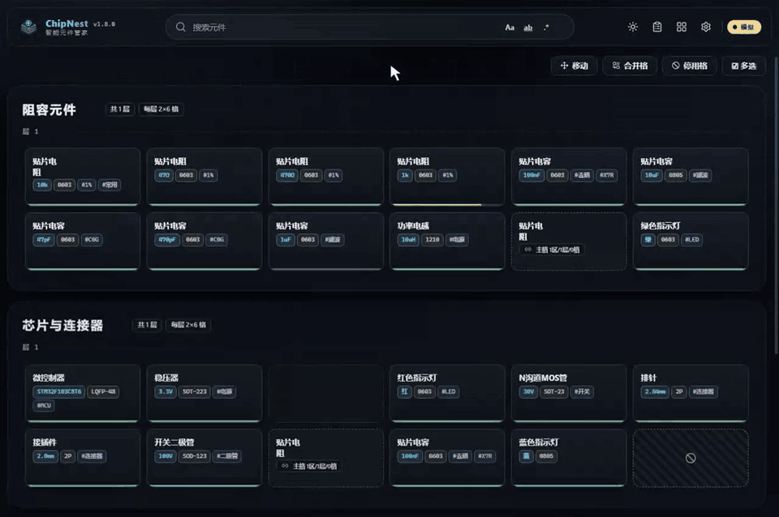

## BOM 取料

1. 打开「库存 → BOM 取料」，选择文件，或粘贴文本后点「解析预览」。
2. 点「匹配库存并规划」，查看取料步骤、缺料与待确认项。
3. 对待确认项选择合适的候选，重新核对数量与规格。
4. 填写项目名称、制作份数后保存，或直接开始引导自动保存项目。
5. 每次确认已取走后，库存扣减与项目进度同时保存。

「已保存项目」可重开清单、恢复人工匹配和取料进度。
制作份数乘以原始单份需求；已开始取料的清单与份数锁定。
可以先取足料部分，补料后点「匹配库存并规划」，只规划尚未取走的行。
重复制作请用「新建制作副本」，重新保存后使用新的取料进度。
删除项目不回退已经发生的出库；出库可以在「操作记录」按顺序撤销。
撤销项目取料时，对应步骤进度也会回退。

下面的演示使用 [示例 BOM](docs/examples/demo_bom.csv)：
电阻与 MOS 管按料号匹配，规格不完整的电容由人确认候选，再依次取料。
示例文件需要仓库中有对应元件；空仓库导入时会显示未找到的项目。

**演示**: 设置制作份数 → 导入 BOM → 确认候选 → 保存项目 →
开始取料 → 中止 → 打开项目 → 继续取料。


### 文件与匹配规则

推荐表头为 `名称、标称值、封装、数量、厂商料号、供应商料号`，
料号与规格填得越完整，越容易确定正确元件。
数量列须为非负整数；型号中的数字不会作为数量拆分。
简单文本也可以写成 `贴片电阻 10k 0603 x3`。

匹配优先使用厂商及供应商料号，也会归一化大小写、全角字符、
常见封装写法与阻容感单位，并从名称和标签读取规格。
已知规格、封装或料号冲突时，不会仅凭普通名称自动选料。

名称近似、信息不足或多个结果接近时，「待确认」最多列出 5 个候选，
提供库存、位置与匹配依据。料号相同但规格冲突时会标出冲突，
需要人工核对；全部待确认项处理后才能开始引导。

<details>
<summary>查看候选列表截图</summary>

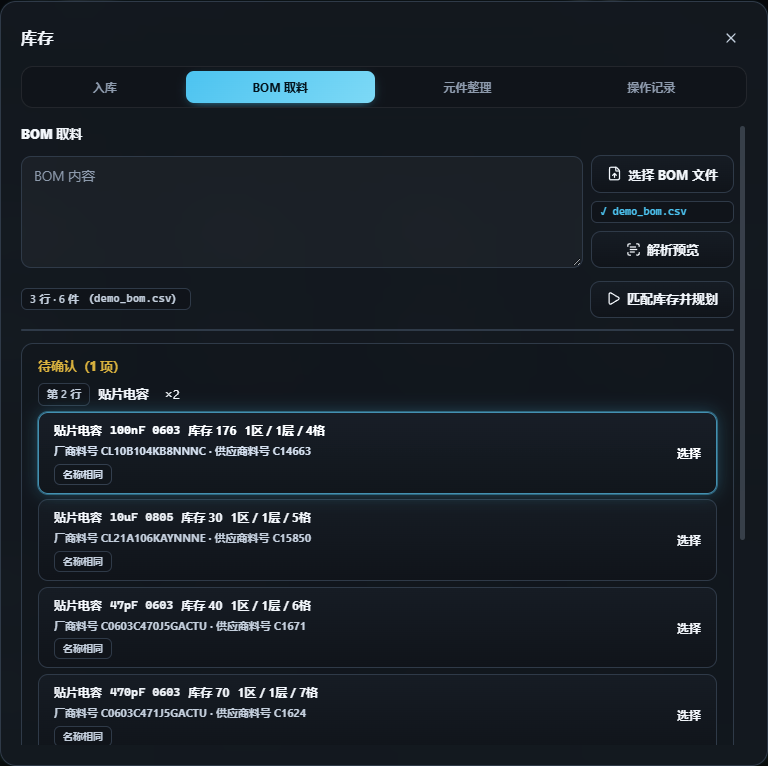

</details>

## 格子管理

### 移动、合并与定位主格

| 操作 | 使用方式 | 结果 |
| --- | --- | --- |
| 移动 | 先点元件，再点目标格 | 搬到空格；目标已有元件时互换位置 |
| 合并格 | 先点要保留的主格，再点空格或相同元件 | 增加存放位置，或合并元件与数量 |
| 定位主格 | 点击副格上的主格位置，或编辑窗口的「定位主格」 | 滚动到主格并短暂高亮 |
| 删除此格 | 打开目标格的编辑窗口并确认删除 | 只删除这个存放位置 |

已有元件手动合并要求名称、标称值、封装、厂商料号和供应商料号一致。
合并后数量相加、标签取并集，保留所选主格的显示设置与补货阈值。
把空格加入同组只增加位置，不增加库存数量。

同组格子共用一份库存。删除副格不会删除其他格子或改变库存；
删除主格时由剩余格子接替，最后一个格子删除后才移除元件记录。
主格搬家或被接替后，副格显示的位置随之更新。

**演示**: 搬家 → 合并空格 → 从副格定位主格 → 只删除一个副格。

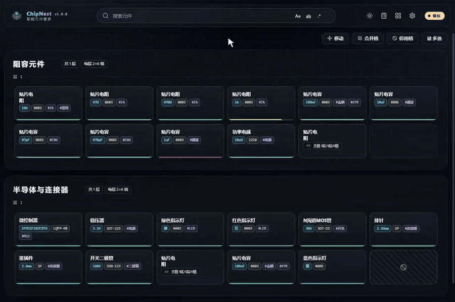

### 停用格与多选

「停用格」用于标记不能使用的空格，再点停用格可恢复。
「多选」按实际存放位置选择；「选本区」只选择当前区中的存放格。
选择后可批量删除格子，同组其他未选中的位置仍保留。

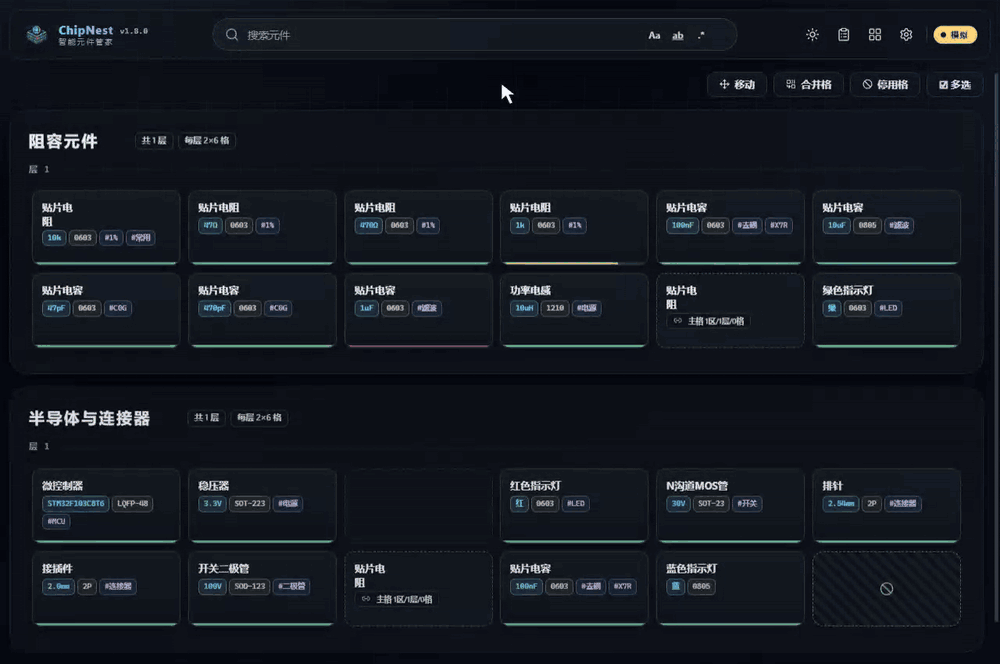

## 元件整理与操作记录

在「库存 → 元件整理」可以先预览重复项，再执行合并。
批量合并按名称、标称值与封装分组，忽略大小写及首尾空白；
保留最早的记录，数量相加、标签取并集，其他位置转为共用格。
预览列出各元件的料号、标签、阈值与卡片显示字段差异。
厂商或供应商料号冲突的组不可批量合并，其余组可以勾选。
空料号由同组已有料号补齐；阈值与卡片显示配置仍保留主格设置。
预览后元件变化会阻止旧预览执行，需重新核对。

同页也可清除勾选元件的供应商料号，不改变数量和位置。
离开「元件整理」后，合并预览与完成提示会清空。

在「操作记录」查看最近操作，并用「撤销上一步」按顺序回退。
一次合并多组元件时，每组分别留下撤销记录，需要逐步撤销。


## 盘点与补货

「库存 → 盘点」按元件显示账面数量，填写实盘数量后点「核对差异」。
确认页显示所有已填且不同的数量，再点「确认校正」整体提交。
未填写的元件不变；多格共用元件只盘点一次，总量计入主格。
盘点期间库存发生变化时整批取消，保留输入供核对。
在「操作记录」撤销可回退整批盘点。


「库存 → 补货清单」可选多个未完成 BOM 项目，同时计入补货阈值。
采购量为 `max(0, 剩余项目需求 + 补货阈值 - 现有库存)`，
已经取走的步骤不再计入需求，同一元件在多个项目中的需求累加。
待人工确认的行只计入待确认数量，确认匹配并保存项目后再汇总。
未找到库存的物料也列入清单，数量为需要采购的总需求。
点「导出 CSV」保存带料号、需求与采购数量的表格，可用 Excel 打开。


## 仓库布局与外观

「仓库布局」按区设置名称、层数与行列尺寸，新建区使用默认尺寸。
缩小布局后，超出范围的元件会列为游离元件，可以搬回空格。

「设置 → 外观」可以切换深浅主题、字号，以及多格卡片合并或分开显示。
弹窗、菜单滑块、页面内容、窗口高度和居中位置会平滑过渡。
系统开启「减少动态效果」时，关闭动画与平滑滚动，保留静态高亮。

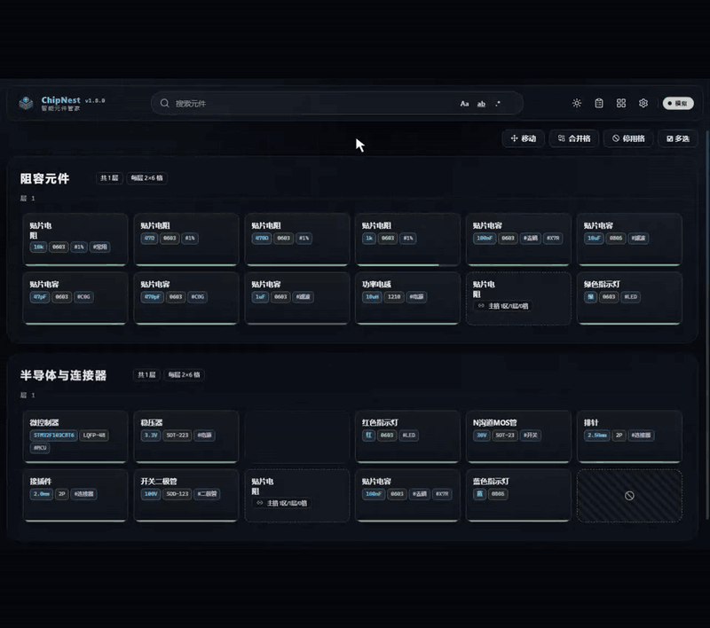

<details>
<summary>查看仓库布局字段截图</summary>

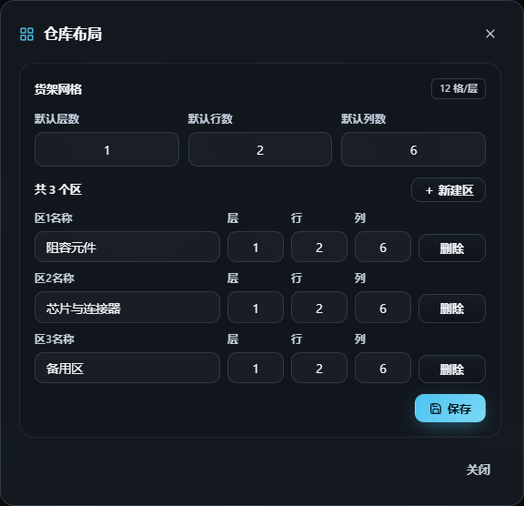

</details>

## 备份与恢复

进入「设置 → 备份与恢复」：

1. 设置自动备份开关、间隔小时、保留份数和目录，点「保存策略」。
2. 点「创建备份」，或在「备份历史」选择已有文件下载。
3. 在历史点「恢复」，或选择外部 JSON 文件，输入「恢复」后确认覆盖。

默认启用自动备份，间隔 24 小时，保留最近 14 份自动备份。
只在应用运行时执行，每分钟检查一次；到期后首次运行也会备份。
保留策略只删除超量的自动备份，手动和覆盖前备份仍保留。
桌面端可使用文件夹选择器；更改目录后，历史只显示新目录中的文件。
历史备份可单独删除，需要再次确认。

恢复会覆盖当前仓库，软件会先备份覆盖前的数据。
「设置 → 数据清理」中的清空操作也会先创建备份。


| 内容 | JSON 备份是否包含 |
| --- | --- |
| 元件字段、标签、显示字段、库存数量与阈值 | 包含 |
| 主格、附加格、仓库布局与停用格 | 包含 |
| 操作流水 | 包含 |
| BOM 清单、人工匹配、制作份数与取料进度 | 包含 |
| 界面偏好、备份策略、联网识别缓存、撤销记录 | 不包含 |

**文件位置**:

```text
%APPDATA%\ChipNest\
├─ chipnest.db          库存数据库
└─ backups\             自动及手动创建的 JSON 备份
```

迁移整份数据库前先关闭软件。请勿把安装目录中的程序文件当作库存数据。

## ESP32 灯带（可选）

仓库可通过 USB 串口连接 ESP32，按槽位灯号指示库存和引导取料。
示例固件位于
[chipnest_led_server.ino](hardware/chipnest_led_server/chipnest_led_server.ino)，
使用 Arduino IDE 与 Adafruit NeoPixel 库。

协议为 115200 8N1 行文本：`PING` → `PONG`，
点灯命令为 `LED:<序号>,<R>,<G>,<B>`。
实体货架硬件尚未制作完成，灯带联动还未做实物验证。
没有硬件时应用使用模拟模式。

## 源码运行与打包

<details>
<summary>开发环境与启动命令</summary>

后端使用 FastAPI、SQLAlchemy 与 SQLite；前端使用 Vue、TypeScript 与 Vite；
桌面端使用 Electron，后端通过 PyInstaller 冻结。
需要 Python 3.12+、Node.js 20.19.x 或 22.12+，以及 npm。

在不同终端分别启动后端与前端：

```powershell
cd backend
python -m venv .venv
.\.venv\Scripts\python.exe -m pip install -r requirements.txt
.\.venv\Scripts\python.exe -m uvicorn app.main:app --port 8765
```

```powershell
cd frontend
npm install
npm run dev
```

前端开发地址为 `http://127.0.0.1:5173`。
如需用 Electron 查看开发界面，保留前端终端、停止独立后端，
在 `electron` 执行 `npm install` 与 `npm run dev`；Electron 自行启动后端。
开发数据库默认位于 `backend/data/`，与安装版用户数据分开。

</details>

<details>
<summary>构建 Windows 安装包与发布</summary>

1. 在 `frontend` 执行 `npm run build`。
2. 在 `backend` 使用 PyInstaller 冻结 `run_desktop.py`：

```powershell
.\.venv\Scripts\python.exe -m PyInstaller --noconfirm --onefile `
  --name chipnest-backend --collect-all pypinyin `
  --collect-submodules uvicorn --hidden-import aiosqlite `
  --hidden-import greenlet --hidden-import websockets `
  --hidden-import python_multipart run_desktop.py
```

3. 在 `electron` 执行 `npx electron-builder --win nsis`。
   安装包生成在 `electron/release/`。

打包版自检设置 `CHIPNEST_SMOKE=1`，并把 `CHIPNEST_SMOKE_DATA_DIR`
指向独立测试目录，避免验证操作或迁移接触正式库存。

国内网络可配置 `ELECTRON_MIRROR` 与
`ELECTRON_BUILDER_BINARIES_MIRROR` 为 npmmirror 镜像。
完整的版本同步、自检、打包与发布流程见
[HANDOFF.md](HANDOFF.md)；本地验证通过后再打标发布。

版本号采用 `MAJOR.MINOR.PATCH`：不兼容改动升主版本，
兼容的新功能或数据结构升次版本，修复、文案和打包调整升修订版本。
同一天的小改动合并发布，已发布版本不重新编号。

</details>

## 常见问题

- **界面没有更新**: 关闭所有 `ChipNest.exe` 进程后重新打开。
- **端口 8765 被占用**: 退出其他 ChipNest 实例或占用端口的开发服务。
- **BOM 没有自动匹配**: 检查料号、规格、封装与候选列表，补全信息后重新规划。
- **布局缩小后找不到元件**: 查看游离元件，并将其搬回空格。
- **串口未连接**: 模拟模式下可以正常使用本地库存与 BOM 功能。
